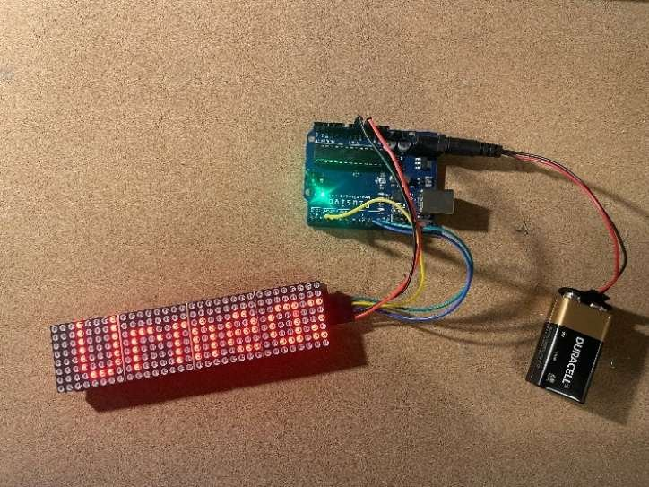
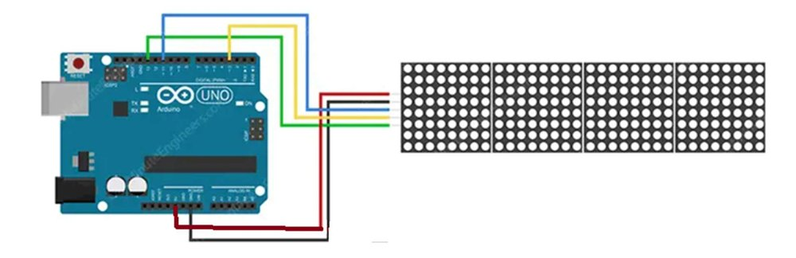
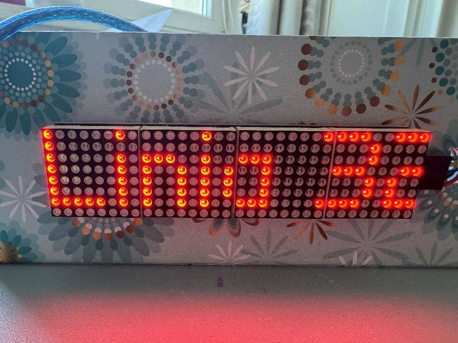
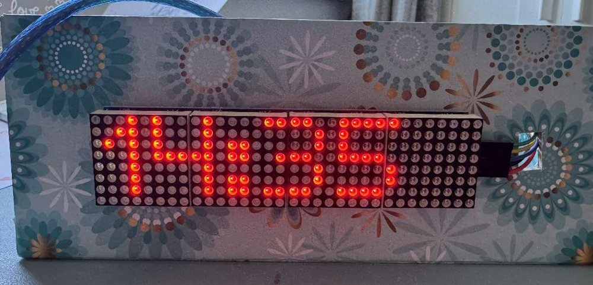
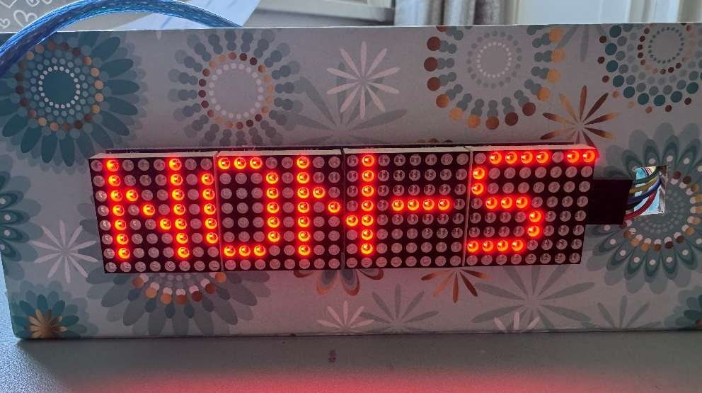
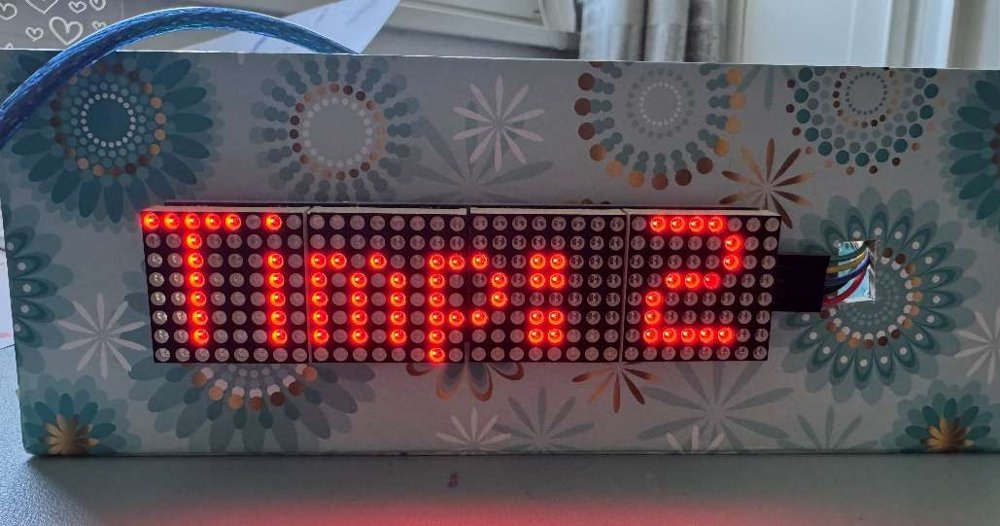
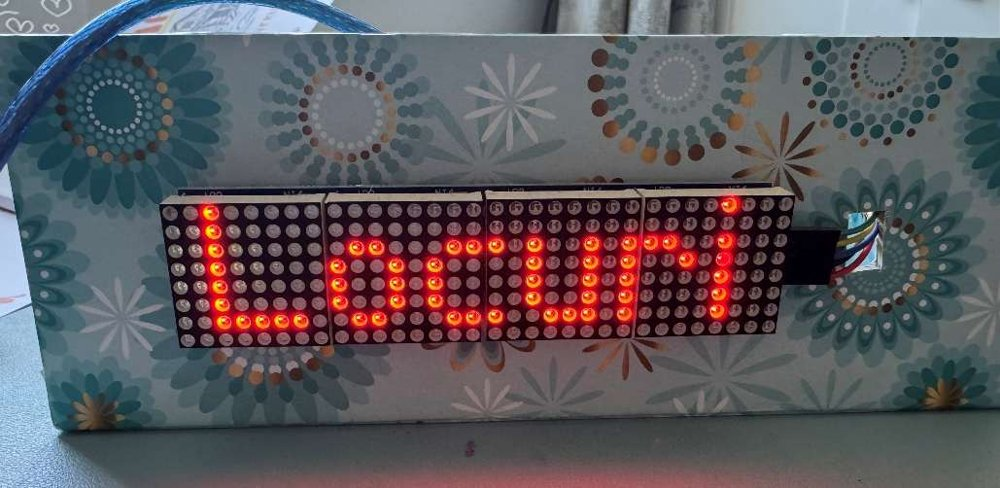
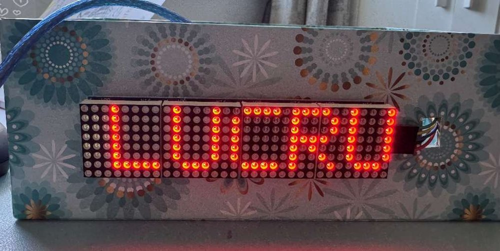

# Afișaj LED tip metrou cu Arduino

Proiect realizat pentru atestatul de informatică, clasa a XII-a, Colegiul Național „Gheorghe Lazăr”, București (2024–2025).

Un afișaj portabil de 32×8 LED-uri, controlat de un Arduino Uno, care rulează anunțuri ca în metrou:
*„Urmează stația TINERETULUI, cu peronul pe partea stângă”*. Pe același hardware am implementat încă 6 aplicații: tramvai, ceas, farmacie, cronometru, parcare și semnal rutier.



▶ **Demo video:** https://youtu.be/ogmQ7_rz0HQ

## Componente

| Componentă | Detalii |
|---|---|
| Placă de dezvoltare | Compatibilă Arduino Uno R3 (ATmega328P, 16 MHz) + cablu USB |
| Afișaj | Modul FC-16: 4 matrice LED 8×8 cu drivere MAX7219 înlănțuite (32×8 LED-uri, 5V) |
| Fire | 5 fire mamă-tată |
| Alimentare portabilă | Fir pentru baterie de 9V cu mufă DC + baterie de 9V |

## Schema de conectare



| Pin matrice | Pin Arduino | Fir |
|---|---|---|
| VCC | 5V | roșu |
| GND | GND | negru |
| DIN | 11 (MOSI) | albastru |
| CS | 3 | galben |
| CLK | 13 (SCK) | verde |

Comunicarea se face prin SPI hardware. Placa e programată prin USB, apoi poate funcționa independent, alimentată de bateria de 9V.

## Software

- Arduino IDE 2.3.2
- Biblioteca **MD_MAX72XX** (MajicDesigns): funcțiile de nivel jos pentru hardware-ul MAX7219
- Biblioteca **MD_Parola** (MajicDesigns): efectele de animație a textului (derulare etc.)
- Biblioteca **SPI**, inclusă în Arduino IDE

Instalare: *Sketch → Include Library → Manage Libraries…*, apoi caută `MD_MAX72XX` și `MD_Parola` și instalează-le.

## Aplicații

Fiecare folder conține un sketch independent, care se deschide direct în Arduino IDE.

| Sketch | Ce afișează | Video |
|---|---|---|
| [`afisaj_metrou`](afisaj_metrou/afisaj_metrou.ino) | „Urmează stația TINERETULUI, cu peronul pe partea stângă” (**proiectul principal**) | [▶](https://youtu.be/ogmQ7_rz0HQ) |
| [`afisaj_tramvai`](afisaj_tramvai/afisaj_tramvai.ino) | „Linia 32 - Piața Rahova -> Gara Progresu” | [▶](https://youtu.be/wKNysKQnm8k) |
| [`afisaj_ceas`](afisaj_ceas/afisaj_ceas.ino) | Ora și data (text fix; poate fi extins cu un modul RTC) | [▶](https://youtu.be/_RsT_gJ-DHI) |
| [`afisaj_farmacie`](afisaj_farmacie/afisaj_farmacie.ino) | „Farmacie deschisă NON-STOP” | [▶](https://youtu.be/jFMzq3rEiK4) |
| [`afisaj_cronometru`](afisaj_cronometru/afisaj_cronometru.ino) | Numărătoare inversă de 10 secunde, actualizată cu `millis()` | [▶](https://youtu.be/q0gaEso8rRo) |
| [`afisaj_parcare`](afisaj_parcare/afisaj_parcare.ino) | „Locuri disponibile: 12” | [▶](https://youtu.be/NqIJuka9Iho) |
| [`afisaj_semnal_rutier`](afisaj_semnal_rutier/afisaj_semnal_rutier.ino) | „ATENȚIE: DRUM ÎN LUCRU!” | [▶](https://youtu.be/4ua_62inbrw) |

| | | |
|---|---|---|
|  |  |  |
|  |  |  |

## Cum funcționează

Toate afișajele cu text în derulare folosesc același tipar:

```cpp
myDisplay.displayScroll(pText, align, textEffect, speed);
```

- `pText`: mesajul afișat
- `align`: alinierea (`PA_CENTER`, `PA_LEFT`, `PA_RIGHT`)
- `textEffect`: efectul de deplasare (de exemplu `PA_SCROLL_LEFT`)
- `speed`: timpul în milisecunde dintre cadre (o valoare mai mică înseamnă o derulare mai rapidă)

În `loop()`, `displayAnimate()` întoarce `true` când textul a terminat de derulat, iar `displayReset()` repornește animația, așa că anunțul se repetă continuu.

Cronometrul folosește `millis()` în loc de `delay()`: actualizează afișajul o dată pe secundă fără să blocheze programul.

## Probleme întâmpinate

- **Placa nu era detectată de Arduino IDE.** Problema s-a rezolvat după repornirea calculatorului.
- **Fire introduse incomplet în pinii matricei.** Matricea nu funcționa corect până când firul nu era fixat bine.
- **Matricea nu se mai aprindea după montarea în carcasă.** Am deconectat firele ca să le trec prin carcasă, iar la reconectare le-am pus în ordine inversă pe pinii matricei. După refacerea legăturilor conform schemei, afișajul a funcționat corect.

## Documentație

Documentația completă (32 de pagini) descrie componentele, codul, schema circuitului, aplicațiile și problemele întâmpinate: [docs/Atestat_matrice_LED_arduino.pdf](docs/Atestat_matrice_LED_arduino.pdf)

## Autoare

**Miruna Maria Sommer**, studentă la Facultatea de Automatică și Calculatoare, UNSTPB POLITEHNICA București
miru.sommer@gmail.com

Schema circuitului este adaptată după tutorialul [Last Minute Engineers – MAX7219 Dot Matrix with Arduino](https://lastminuteengineers.com/max7219-dot-matrix-arduino-tutorial/).
